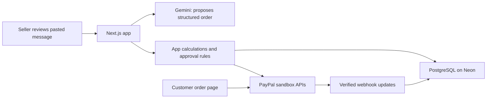

# SellerSide Pro

An order and refund assistant for sellers who receive customer requests in chat. Home bakers are our first example audience.

## Current state

- Local Next.js preview: searchable AG Grid order dashboard, preset order walkthrough, customer-page preview, sample refund calculation and review.
- The preview uses fictional sample records. No AI requests, database persistence, checkout, or refunds are connected to these sample records.
- The separate sandbox integration probe has successfully created and captured a USD 60 test payment and completed a USD 15 partial refund. This is a manual integration result, not an automated test assertion.
- PayPal approval/cancellation return pages now explain the next step without assuming payment succeeded.

## Run locally

Requires Node.js 22 or 24 (the initial build is checked on Node 22). No service credentials are needed for the sample screens.

```sh
npm ci
npm run dev
```

Open http://127.0.0.1:3000. The preview server binds to the local computer only. Customer sample: `/order/sample`.

## Verify

```sh
npm test
npm run typecheck
npm run build
```

## PayPal sandbox integration probe

Copy `.env.example` to `.env.local` and privately fill in sandbox app credentials. Never publish credentials or `.local` records. The probe hardcodes PayPal's sandbox endpoint and cannot target live payments.

```sh
node scripts/paypal-smoke.mjs create
# Open the returned URL and approve as a distinct sandbox PERSONAL buyer.
node scripts/paypal-smoke.mjs status
node scripts/paypal-smoke.mjs capture
node scripts/paypal-smoke.mjs refund --approve-test-refund
node scripts/paypal-smoke.mjs status
```

The test order is USD 60; the refund is USD 15. Only sandbox money is used. State and request IDs persist in ignored `.local/paypal-smoke.json`; preserve that file when retrying an uncertain request to avoid changing the request identity. Run status after a timeout. This is an operator integration probe, not the eventual production payment service. The return page does not capture automatically.

## Planned connections



Next: provider-independent AI module, PostgreSQL records and approval controls, then integrate the tested payment actions into real saved orders. Hosting remains undecided pending free-plan eligibility and quota checks.

## License

MIT. Third-party dependencies retain their respective licenses.
